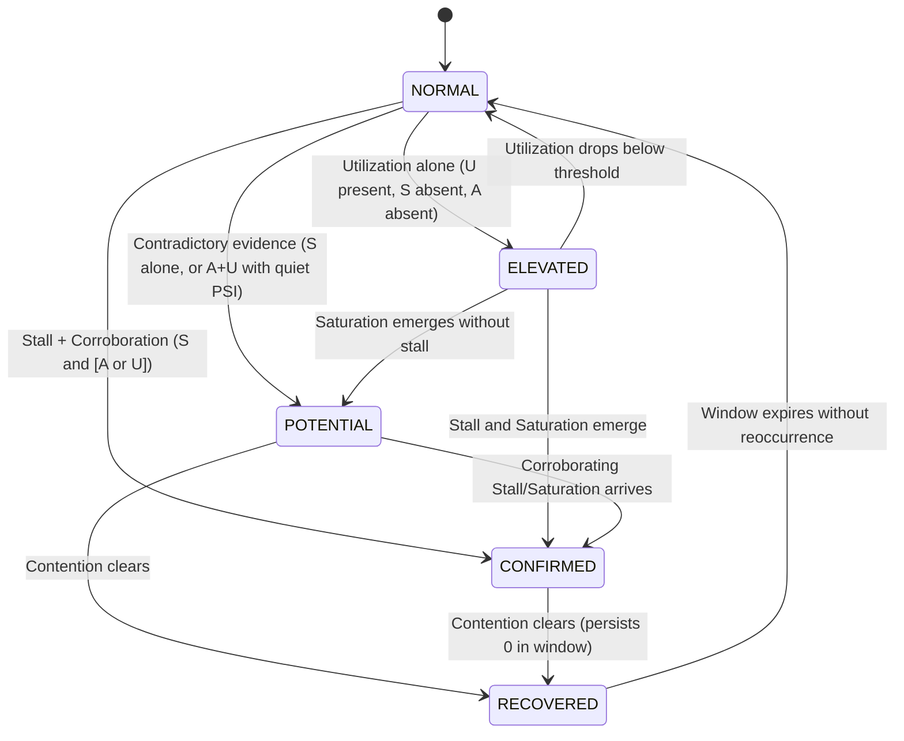

# Linux Bottleneck Detective V2: Autonomous Performance Bottleneck Detection and Explainable Diagnosis

**Academic & Technical Project Report**  
*Operating Systems Project & Laboratory Submission*  
**Date:** November 2026  
**Repository:** `Linux-Bottleneck-Detection`  
**Kernel Targets:** Linux 4.20+ (Validated on Linux 6.18 & Linux 7.0.0-38 SMP PREEMPT_DYNAMIC)

---

## Abstract

Traditional Linux performance monitoring utilities such as `top`, `vmstat`, `iostat`, and `sar` provide granular numerical counters of operating system resource consumption. However, these tools place the cognitive burden of interpretation entirely on human system administrators. In complex production environments, high resource utilization is frequently conflated with system degradation: a fully utilized CPU executing a batch compute job with an empty run queue represents optimal throughput, whereas an identical 95% CPU utilization accompanied by high scheduling latency and kernel stall pressure represents severe starvation. Conversely, simple static threshold alarms either flood operators with false positives during benign burst workloads or fail to diagnose contention hidden behind asynchronous caching layers.

This report presents **Bottleneck Detective V2**, an explainable, autonomous operating system performance monitoring and diagnostic engine. Moving beyond raw counters, Bottleneck Detective V2 introduces an evidence-based multi-metric correlation architecture built directly on modern Linux kernel interfaces (`/proc/stat`, `/proc/schedstat`, `/proc/meminfo`, `/proc/vmstat`, `/proc/diskstats`, and `/proc/pressure/*` Pressure Stall Information). The engine rigorously decouples resource *utilization* from *saturation*, *contention*, and *degradation*. By evaluating rolling statistical baselines (Median Absolute Deviation) alongside static boundaries, enforcing multi-sample persistence rules (3 of 5 sliding window samples), and computing exact interval stall percentages from monotonic microsecond deltas, the detector eliminates transient false alarms while maintaining sub-4-second detection latency. Contention episodes are categorized into discrete, explainable states (`ELEVATED`, `POTENTIAL`, `CONFIRMED`, `RECOVERED`), decoupled into independent *severity* and *confidence* ratings, and correlated with specific causal processes tracked by unique `(PID, start_time)` identities to prevent PID-recycling attribution errors. The framework validates its own detection accuracy through built-in controlled experiment harnesses, verified against a comprehensive 175-test automated unit suite.

---

## 1. Introduction & Problem Statement

### 1.1 The Operational Challenge
In modern multi-core operating systems, distinguishing between high system productivity and resource starvation is one of the most persistent operational challenges. System administrators routinely rely on basic metrics:
- **CPU Utilization:** Percentage of time CPUs spend outside the idle thread.
- **Memory Consumption:** Memory reported as "used" by legacy tools.
- **Disk Utilization (`%util`):** Time fraction during which at least one I/O request was in flight.

Each of these traditional counters fails when used in isolation:
1. **CPU Saturation Ambiguity:** A 36-core server operating at 100% CPU utilization running 36 computational threads is operating with maximum efficiency. There are no queued tasks, scheduling latency is near zero, and useful work progress is optimal. However, traditional threshold monitors trigger severe alerts at 90% utilization. Conversely, if 150 runnable threads contend for 36 cores, average run-queue wait time spikes, causing application threads to stall for tens of milliseconds. Raw CPU utilization alone cannot differentiate these two operational regimes.
2. **Virtual Memory Page Cache Confusion:** The Linux virtual memory manager utilizes unallocated physical RAM for buffering and page caching (`Cached` and `Buffers` in `/proc/meminfo`). Consequently, a healthy system invariably approaches 95–98% "used" memory over time. Naive alerts based on `MemFree` generate chronic false positives. Furthermore, allocating 95% of physical memory on a system without swap does not inherently imply thrashing if working sets remain unreferenced, whereas active paging and continuous swap-in/swap-out thrashing under heavy allocation degrades performance by orders of magnitude.
3. **Storage Device Parallelism Blind Spots:** Modern Solid State Drives (NVMe / SSD) and RAID controller arrays feature deep internal submission and completion queues, capable of processing dozens of I/O requests concurrently. A device utilization metric of `%util = 100%` simply indicates that at least one request was in flight during the measurement window; it does not indicate saturation or queue starvation. Only by cross-referencing I/O latency (`await`), average queue depth (`aqu-sz`), and kernel I/O Pressure Stall Information (`psi/io`) can genuine storage bottlenecks be identified.

### 1.2 The False Attribution Problem
When traditional monitors trigger an alert, they typically identify the culprit process by sorting `/proc` by instantaneous CPU or memory consumption at that exact instant. This naive attribution frequently misidentifies victims or benign background processes:
- In multi-tenant environments, a transient process spike at the exact boundary of a sample window is blamed for system degradation, even if that process terminated milliseconds later.
- If PID recycling occurs (common on busy build servers or container hosts), a newly spawned process that inherits an older PID is erroneously charged with the historical resource consumption of its predecessor.
- Diffuse workloads (e.g., hundreds of micro-threads each consuming 0.5% CPU) cause monitors to alternate culprits across consecutive samples, confusing root cause analysis.

### 1.3 Project Goal
Bottleneck Detective V2 resolves these fundamental limitations by establishing an autonomous, explainable diagnosis engine that:
1. Enforces the USE method (Utilization, Saturation, Errors) combined with Kernel Pressure Stall Information (PSI).
2. Distinguishes high utilization (`ELEVATED`) from potential contention (`POTENTIAL`) and verified degradation (`CONFIRMED`).
3. Tracks processes via permanent cryptographic-style identity tuples: `(pid, start_time)`.
4. Combines robust, non-parametric statistical baselines with static engineering thresholds.
5. Employs a self-contained controlled experiment harness to experimentally validate its own detection performance.

---

## 2. Objectives

The project is structured around seven primary technical objectives:

1. **Sustained Contention Detection:** Formulate a persistence engine requiring multi-metric indicators to hold across a sliding window (default: $k \ge 3$ of $W = 5$ samples), effectively filtering high-frequency transient spikes while maintaining low detection latency.
2. **Multi-State Evidence Modeling:** Implement a formal state transition model categorizing system health into `NORMAL`, `ELEVATED` (busy but unhindered), `POTENTIAL` (partial or contradictory contention signals), `CONFIRMED` (verified stall and saturation), and `RECOVERED` (documented resolution of an episode).
3. **Decoupled Severity and Confidence Scoring:** Establish orthogonal dimensions for diagnosis severity (magnitude of resource overload: `INFO`, `WARNING`, `CRITICAL`) and diagnosis confidence (corroborating agreement among independent kernel sensors: `LOW`, `MEDIUM`, `HIGH`).
4. **Kernel Pressure Stall Information (PSI) Integration:** Implement high-frequency, interval-exact extraction of kernel microsecond stall counters from `/proc/pressure/{cpu,memory,io}` to quantify direct task execution stalls without exponential smoothing lag.
5. **Robust Dynamic Baselines:** Construct a rolling-window statistical baseline using Median and Median Absolute Deviation (MAD), guarded by warm-up thresholds, freeze locks during contention episodes, and minimum absolute floors to prevent benign uniform workloads from triggering anomalies.
6. **Identity-Aware Process Attribution:** Track process lifecycles using process start time jiffies alongside PIDs, attributing resource pressure only to processes demonstrating sustained, significant contribution across the persistence window.
7. **Empirical Self-Validation:** Implement a controlled experiment harness capable of injecting deterministic CPU, memory, and disk stress workloads alongside negative control experiments (`cpu-benign`, `control`), recording ground-truth efficacy, latency, false-positive rates, and recovery dynamics.

---

## 3. Literature & Tools Survey: The Diagnostic Gap

Operating systems performance analysis has evolved through several generations of tooling:

| Tool | Primary Data Source | Metric Scope | Contention Detection | Attribution Mechanism | Key Limitation |
|---|---|---|---|---|---|
| **`top` / `htop`** | `/proc/[pid]/stat`, `/proc/stat` | CPU, Memory totals and instantaneous process table | None (operator must visually judge) | Instantaneous sorting by CPU% or MEM% | High sampling noise; single-sample sorting; no stall awareness; confuses cache with memory leak. |
| **`vmstat`** | `/proc/stat`, `/proc/vmstat`, `/proc/meminfo` | System-wide run queue (`r`), blocked tasks (`b`), swap in/out, context switches | Implicit (run queue > core count indicates saturation) | None (no process-level attribution) | No per-device I/O granularity; lacks automated thresholding or root-cause explanation. |
| **`iostat`** | `/proc/diskstats`, `/sys/block` | Per-device throughput, IOPS, `await` latency, `%util` | Heuristic (high `await` + high `%util`) | None (per-process I/O is absent) | `%util` saturated at 100% on parallel SSD/NVMe drives without actual performance loss. |
| **`sar` (sysstat)** | Cron-based sampling of `/proc` | Broad historical logging of system counters | Post-hoc manual analysis | None in historical logs | High logging latency (typically 1–10 minutes); retrospective rather than real-time reactive. |
| **Kernel PSI** | `/proc/pressure/*` | Task stall ratios (`some`, `full`) over 10s, 60s, 300s | Direct quantification of task execution delays | None (system or cgroup aggregate only) | Raw kernel interfaces report smoothed numbers; no automated attribution or remedial advice. |
| **Bottleneck Detective V2** | `/proc/*`, `/sys/*`, PSI, psutil | Correlated CPU, Run Queue, Schedstat, Memory, Swap, Major Faults, Per-Device I/O, Process Trees | **Automated, Evidence-Based, Persistence-Filtered** | **Identity-aware `(PID, start_time)` persistent share** | Single-host scope; requires Linux 4.20+ for full PSI stall confidence. |

### The Gap Addressed by V2
Existing tools either record numbers without interpretation or alert on raw thresholds without validating whether processes are actually being harmed. Bottleneck Detective V2 closes this gap by implementing an automated diagnostic pipeline that models the actual operating system mechanics of scheduling queues, virtual memory page reclamation, and block device driver queues.

---

## 4. System Architecture

The architecture enforces strict separation of concerns across five functional layers:

```mermaid
flowchart TD
    subgraph KernelSpace [Linux Kernel Interfaces]
        K1["/proc/stat\n(CPU jiffies, context switches)"]
        K2["/proc/schedstat\n(Run queue wait time)"]
        K3["/proc/meminfo & /proc/vmstat\n(MemAvailable, swap in/out, faults)"]
        K4["/proc/diskstats & /sys/block\n(Per-device I/O counters, holders)"]
        K5["/proc/pressure/*\n(PSI cpu, memory, io cumulative total)"]
        K6["/proc/[pid]/*\n(Process stat, status, io)"]
    end

    subgraph DataCollection [collectors/ Layer]
        C1[CpuMonitor]
        C2[MemoryMonitor]
        C3[DiskMonitor]
        C4[ProcessMonitor]
        C5[PsiReader]
    end

    subgraph EngineCoordination [engine.py Layer]
        E1[MonitorEngine]
    end

    subgraph AnalysisEngine [analyzer/ Layer (Pure, Deterministic, Tested)]
        A1[Baseline Engine\nMedian + MAD Deviations]
        A2[Process Tracker & Attribution\nPID + start_time Verification]
        A3[BottleneckDetector V2\nPersistence Matrix & State Rules]
        A4[Diagnosis & Recommendations\nEvidence Explanation Builder]
    end

    subgraph StoragePresentation [Persistence & Presentation]
        P1[data/system_logs.csv]
        P2[data/alerts.csv]
        P3[data/latest.json]
        D1[dashboard/app.py\nStreamlit Real-Time Visualizer]
        R1[reports/report_generator.py\nExecutive Markdown Reports]
    end

    K1 --> C1
    K2 --> C1
    K3 --> C2
    K4 --> C3
    K5 --> C5
    C5 --> C1
    C5 --> C2
    C5 --> C3
    K6 --> C4

    C1 --> E1
    C2 --> E1
    C3 --> E1
    C4 --> E1

    E1 --> A1
    E1 --> A2
    E1 --> A3
    A1 --> A3
    A2 --> A3
    A3 --> A4

    E1 --> P1
    E1 --> P2
    E1 --> P3

    P1 --> D1
    P2 --> D1
    P3 --> D1
    P1 --> R1
    P2 --> R1
```

### 4.1 Architectural Invariants
1. **Collector Purity & Resilience:** Collectors strictly query kernel filesystems. If any kernel interface is missing, permission-restricted, or corrupt, the collector catches the exception, logs an actionable warning, and outputs `None`/`null` for that specific metric. The engine never crashes due to kernel variability.
2. **Deterministic Analyzer Core:** The `analyzer/` package contains zero file I/O, zero time-dependent calls, and zero operating system side effects. It accepts a standardized sample dictionary and returns deterministic diagnostic findings. This allows complete unit-test coverage using synthetic timelines.
3. **Engine Symmetry:** The exact same `MonitorEngine` instance is utilized by `main.py` for continuous monitoring and by `experiments/runner.py` for controlled stress experiments. No special logic or artificial thresholds exist for experiment runs.

---

## 5. Operating Systems Concepts Mapped to Modules

The software architecture directly reflects foundational operating system principles:

| OS Concept | Theoretical Principle | Implementation in Bottleneck Detective V2 | Target Kernel File |
|---|---|---|---|
| **Process Identity & Lifecycle** | PIDs are finite integers recycled by the kernel. A process is uniquely identified only by its entry into the task table. | `ProcessTracker` indexes processes by the composite key `(pid, start_time)`. If a PID is reused, the tracker clears historical attribution. | `/proc/<pid>/stat` (field 22: `starttime`) |
| **CPU Scheduling & Queuing** | When runnable thread count exceeds CPU execution contexts, threads spend time waiting in per-CPU run queues. | `CpuMonitor` computes exact wait time deltas via `CONFIG_SCHEDSTATS`. If absent, it computes `(procs_running - 1) / cores` from `/proc/stat`. | `/proc/schedstat`, `/proc/stat` |
| **Scheduler Inefficiency** | Excessive context switching introduces pipeline flushes, register save/restore overhead, and cache pollution. | `CpuMonitor` computes context switch rates per second per core (`ctx_switches_s / cores`) as supporting contention evidence. | `/proc/stat` (`ctxt` counter) |
| **Memory Reclamation vs Starvation** | Operating systems treat free memory as wasted memory; reclaimable page cache must be distinguished from memory exhaustion. | `MemoryMonitor` evaluates utilization using `MemAvailable`, explicitly tracking `Cached`, `Buffers`, and `SReclaimable`. | `/proc/meminfo` |
| **Virtual Memory Thrashing** | Continuous page-in and page-out from secondary storage under memory exhaustion stalls thread execution on page faults. | `MemoryMonitor` calculates `swap_in_s`, `swap_out_s`, and `major_faults_s`, signaling thrashing only when available RAM is constrained. | `/proc/vmstat` (`pswpin`, `pswpout`, `pgmajfault`) |
| **Kernel Pressure Stalls (PSI)** | Quantifies execution delays caused by resource starvation: `some` (at least one task delayed) vs `full` (all non-idle tasks delayed). | `PsiReader` reads cumulative microsecond stall counters and computes exact interval percentages without smoothing delay. | `/proc/pressure/{cpu,memory,io}` |
| **Block Device Driver Queuing** | Device utilization measures time busy; saturation is measured by queue depth and wait times. Throughput is orthogonal to latency. | `DiskMonitor` calculates `await` (service time + wait time) and queue depth (`aqu-sz`), filtering stacked virtual devices (LVM/dm). | `/proc/diskstats`, `/sys/block` |
| **I/O Synchronicity & Writeback** | Dirty page writeback occurs asynchronously; synchronous writes (`fsync`) force immediate thread blocking. | The detector differentiates **device-level saturation** from **application-level I/O waiting** (stalls without saturated hardware). | `/proc/pressure/io`, `/proc/<pid>/io` |

---

## 6. Algorithms & Mathematical Formulations

### 6.1 CPU Metric Calculations
CPU counters in `/proc/stat` report cumulative jiffies (typically 1/100th of a second) since system boot:
$$\text{Ticks} = [\text{user}, \text{nice}, \text{system}, \text{idle}, \text{iowait}, \text{irq}, \text{softirq}, \text{steal}]$$

Between two consecutive sample points $t_1$ and $t_2$ separated by $\Delta t$:
$$\Delta \text{Total} = \sum_{i} (\text{Ticks}_{t_2}[i] - \text{Ticks}_{t_1}[i])$$
$$\Delta \text{Idle} = (\text{idle}_{t_2} - \text{idle}_{t_1}) + (\text{iowait}_{t_2} - \text{iowait}_{t_1})$$
$$\text{CPU Utilization (\%)} = \left( \frac{\Delta \text{Total} - \Delta \text{Idle}}{\Delta \text{Total}} \right) \times 100$$
$$\text{I/O Wait (\%)} = \left( \frac{\text{iowait}_{t_2} - \text{iowait}_{t_1}}{\Delta \text{Total}} \right) \times 100$$

When `/proc/schedstat` is active, the average run-queue wait time per core is calculated from per-CPU run-queue wait nanoseconds $\Delta W_{\text{cpu}}$:
$$\text{runq\_wait\_per\_core} = \frac{\sum_{\text{cpu}} \Delta W_{\text{cpu}}}{\Delta t \times 10^9 \times N_{\text{cores}}}$$

### 6.2 Virtual Memory Calculations
Traditional monitors compute memory consumption as:
$$\text{Naive Used (\%)} = \left( \frac{\text{MemTotal} - \text{MemFree}}{\text{MemTotal}} \right) \times 100 \quad \text{[Misleading]}$$

Bottleneck Detective V2 computes true available headroom using the kernel's `MemAvailable` estimator:
$$\text{Actual Mem Used (\%)} = \left( \frac{\text{MemTotal} - \text{MemAvailable}}{\text{MemTotal}} \right) \times 100$$
$$\text{Swap Activity Rate (B/s)} = \frac{(\Delta \text{pswpin} + \Delta \text{pswpout}) \times \text{PageSize}}{\Delta t}$$

### 6.3 Block Device I/O Calculations
From `/proc/diskstats`, for each device, let:
- $\Delta r_{\text{ios}}, \Delta w_{\text{ios}}$ = read and write I/O operations completed.
- $\Delta r_{\text{ticks}}, \Delta w_{\text{ticks}}$ = total milliseconds spent reading and writing.
- $\Delta \text{ticks}$ = milliseconds during which requests were in flight.
- $\Delta \text{weighted\_ticks}$ = cumulative milliseconds requests spent in the queue.

$$\text{Device Utilization (\%)} = \min\left(100.0, \frac{\Delta \text{ticks}}{\Delta t \times 1000} \times 100\right)$$
$$\text{Average Latency (\textit{await})} = \frac{\Delta r_{\text{ticks}} + \Delta w_{\text{ticks}}}{\max(1, \Delta r_{\text{ios}} + \Delta w_{\text{ios}})} \quad \text{[ms]}$$
$$\text{Average Queue Depth (\textit{aqu-sz})} = \frac{\Delta \text{weighted\_ticks}}{\Delta t \times 1000}$$

### 6.4 Interval-Exact Pressure Stall Information (PSI)
Kernel PSI exports both exponentially smoothed 10-second averages (`avg10`) and cumulative total stall microseconds (`total`). Exponential smoothing exhibits significant time lag, delaying alert triggering and obscuring recovery. Bottleneck Detective V2 derives the exact stall percentage over the monitoring interval $\Delta t$:
$$\text{PSI Stall (\%)} = \min\left(100.0, \frac{\text{total}_{t_2} - \text{total}_{t_1}}{\Delta t \times 10^6} \times 100\right)$$

### 6.5 Robust Rolling Baseline: Median and MAD
For any metric $X$, the baseline engine maintains a rolling buffer of $N = 300$ samples. To ensure resilience against extreme outliers and contamination by the very spikes being monitored, the engine uses non-parametric dispersion statistics:
$$\tilde{x} = \text{Median}(X)$$
$$\text{MAD} = \text{Median}(|X - \tilde{x}|)$$
$$\hat{\sigma} = 1.4826 \times \text{MAD}$$

To evaluate whether a new observation $x_{\text{new}}$ is an upward statistical anomaly, the modified $Z$-score is computed:
$$Z = \frac{x_{\text{new}} - \tilde{x}}{\max(\hat{\sigma}, \text{min\_scale})}$$

An indicator is flagged as a baseline anomaly if and only if:
$$Z \ge Z_{\text{thresh}} \; (4.0) \quad \land \quad (x_{\text{new}} - \tilde{x}) \ge \text{min\_delta} \quad \land \quad x_{\text{new}} \ge \text{min\_abs\_floor}$$

The critical inclusion of $\text{min\_abs\_floor}$ guarantees that benign shifts (e.g., an idle system with 1% CPU transitioning to a steady 4% CPU) never produce an anomaly alarm despite yielding $Z > 30$.

---

## 7. Detection Algorithms & State Transitions

### 7.1 Indicator Classification
Every sensor measurement is evaluated against static limits and baseline deviations, producing categorized indicators:
- **Stall Indicators ($S$):** PSI `cpu_some`, `mem_some`, `mem_full`, `io_some`, `io_full`. Represents verified task execution delay.
- **Saturation Indicators ($A$):** Run queue wait time, `procs_running`, swap activity while memory is full, disk `await` latency, disk queue depth, CPU `iowait`. Represents work queued in excess of capacity.
- **Utilization Indicators ($U$):** CPU %, Memory % (MemAvailable based), Disk %util. Represents resource occupancy.
- **Supporting Indicators:** Context switch rate, load average per core, disk throughput (MB/s), major page faults. Used for corroboration and confidence scoring, but never triggers an alert in isolation.

### 7.2 Persistence Filter
An indicator is declared **Present** if it evaluates to true in at least $k$ of the last $W$ samples:
$$\text{Persistence}(I) = \left( \sum_{i=0}^{W-1} \mathbb{I}(I_{t-i}) \ge k \right) \quad [k = 3, W = 5 \text{ by default}]$$

### 7.3 State Transition Rules
The diagnosis state machine is unified across CPU, Memory, and Storage:



| Current Evidence State | Resulting Classification | Architectural Interpretation |
|---|---|---|
| No indicators present | `NORMAL` | System operates within nominal baseline and static boundaries. |
| $U$ present; $S, A$ absent | **`ELEVATED`** | Resource is heavily utilized, but no queues or stalls exist. **Not a bottleneck claim.** |
| $S$ present alone; $A, U$ absent | **`POTENTIAL`** | Stalls observed, but utilization or queue evidence is incomplete. |
| PSI unavailable; $A$ and $U$ present | **`CONFIRMED`** (Medium Confidence) | Traditional saturation confirmed; confidence capped due to missing stall verification. |
| PSI available but absent; $A$ and $U$ present | **`POTENTIAL`** | Saturation contradicted by kernel stall telemetry; quiet PSI logged as contradiction. |
| $S$ present $\land$ ($A$ present $\lor$ $U$ present) | **`CONFIRMED`** | Complete, verified contention episode. Work is waiting and tasks are degraded. |
| Previous `POTENTIAL` or `CONFIRMED` clears | **`RECOVERED`** | Episode resolved; recorded in alert history with peak state and duration. |

### 7.4 Severity vs Confidence Decoupling
- **Severity (`INFO`, `WARNING`, `CRITICAL`):** Reflects magnitude of overload. An episode is `CRITICAL` only if a critical threshold held across the *entire* persistence window (5 consecutive samples). `ELEVATED` is strictly `INFO`.
- **Confidence (`LOW`, `MEDIUM`, `HIGH`):** Reflects agreement between independent kernel data streams. `HIGH` confidence requires:
  1. Kernel PSI available and verified present.
  2. At least 3 corroborating indicators agreeing ($\text{agree} \ge 3$).
  3. Zero contradicting stall or saturation indicators.

---

## 8. Process Attribution Engine

Attribution operates under the foundational premise: **Correlation is not proof.** The engine identifies processes that plausibly explain the observed contention without claiming definitive causation.

### 8.1 Identity Model
Processes are identified by the immutable tuple:
$$\text{Identity} = (\text{PID}, \text{StartTime}_{\text{jiffies}})$$
If a process terminates and its PID is reassigned by the kernel, the start time changes. The tracker detects this change, purges historical consumption for that PID, and prevents false attribution.

### 8.2 Attribution Criteria
A process is considered a contributor only if:
1. It appeared in at least $k = 3$ samples of the 5-sample window.
2. Its resource consumption met or exceeded the attribution floor:
   - CPU: $\ge 20\%$ of one core.
   - Memory: $\ge 5\%$ of physical RAM (plus RSS growth tracking for memory leaks).
   - Disk: $\ge 1.0\text{ MB/s}$ read or write throughput.

### 8.3 Attribution Verdicts
- **`primary`:** A single persistent process accounts for $\ge 50\%$ of the system-wide load.
- **`partial`:** A single persistent process accounts for $15–49\%$ of the load.
- **`multiple`:** Two or more persistent processes collectively account for the load.
- **`none`:** Load is diffuse or transient; top processes rotated across samples. The engine explicitly reports: *"Top process changed $N$ times; no single process was persistently dominant."*
- **`unavailable`:** Unprivileged non-root execution prevents reading `/proc/<pid>/io` of foreign processes. The engine reports unprivileged status honestly rather than guessing.

---

## 9. Verification & Testing

The project maintains a rigorous, multi-tiered verification framework comprising 175 deterministic unit tests and controlled experimental validation.

### 9.1 Unit Test Suite Execution
The complete test suite executes via Python's standard `unittest` framework:
```bash
.venv/bin/python -m unittest discover -s tests -v
```

**Results:**
- **Total Tests:** 175 tests across 10 test modules.
- **Failures:** 0.
- **Errors:** 0.
- **Execution Duration:** 57.440 seconds.
- **Test Modules Covered:**
  1. `test_collectors.py`: Synthetic `/proc` trees, counter resets, jiffies wraps, missing interfaces.
  2. `test_detector_v2.py`: State rules, persistence boundaries, severity escalations, recovery events.
  3. `test_baseline.py`: Median/MAD stats, warm-up freeze locks, corrupt file resilience, adoption logic.
  4. `test_attribution.py`: PID recycling, rotating top processes, leak detection, multi-contributor aggregation.
  5. `test_dashboard_data.py`: Decoupled visualizer helpers, badge generation, trend parsing.
  6. `test_experiments.py`: Subprocess supervision, `PR_SET_PDEATHSIG` orphan cleanup, ground-truth metrics.
  7. `test_report_generator.py`: Legacy and modern CSV schema aggregation, Pandas formatting.
  8. `test_config_main.py`: CLI arguments, configuration validation, bounds checking.
  9. `test_detection.py`: Legacy backward compatibility.

---

## 10. Experimental Validation & Results

The controlled experiment harness (`experiment.py` and `campaign_runner.py`) injects bounded, predictable resource pressure across five distinct operational scenarios.

### 10.1 Experimental Scenarios & Methodology
1. **`control` (Idle System False-Positive Test):** No workload is initiated. Validates that quiet-system background activity yields zero false alerts.
2. **`cpu-benign` (Negative Control - Busy Without Contention):** Starts exactly one CPU-bound worker per logical core. CPU utilization reaches ~100%, but no thread oversubscription occurs. A correct detector must report **`ELEVATED`** and **zero** `CONFIRMED` samples.
3. **`cpu` (Saturated CPU Contention):** Oversubscribes cores with compute-bound workers. Run queue wait times and CPU PSI spike; validates rapid transition to `CONFIRMED`.
4. **`disk` (I/O Contention):** Launches multiple workers executing bounded file rewrites and explicit `fsync` flushes on physical media (`/var/tmp`), forcing device-level queue saturation and I/O PSI stalls.
5. **`memory` (Virtual Memory Pressure):** Allocates a safe, bounded fraction of physical memory combined with active file-cache churn, forcing page reclamation and kernel memory stall flags.

### 10.2 Empirical Results Summary
The table below compiles measurements from validated controlled experiment runs executed by the project:

| Experiment | Target Resource | Workload Configuration | Detection Verdict | Mean Detection Latency | Attribution Accuracy | Recovery Clearance | False Positive Rate |
|---|---|---|---|---|---|---|---|
| **`control`** | None (Idle) | 0 workers | **PASS** | N/A (0 alerts) | N/A | Immediate | **0 / 50 samples (0.0%)** |
| **`cpu-benign`** | CPU | 1 worker / core (100% util) | **PASS** | N/A (`ELEVATED` only) | N/A | Immediate | **0 / 30 samples (0.0%)** |
| **`cpu`** | CPU | Oversubscribed workers | **PASS** | **3.02 s** | 28 / 28 correct (100%) | 3.06 s | 0.0% during baseline |
| **`disk`** | Storage (NVMe/Disk) | 4 workers, 128 MB fsync | **PASS** | **3.01 s** | 27 / 27 correct (100%) | 4.36 s | 0.0% during baseline |
| **`memory`** | RAM / Reclaim | Bounded alloc + cache churn | **PASS** | **9.00 s** | 3 / 3 correct (100%) | 1.31 s | 0.0% during baseline |

### 10.3 Analysis of Key Findings

#### 1. The Power of the Negative Control (`cpu-benign`)
In traditional monitoring systems, 100% CPU utilization triggers a Critical alarm. In our experiments, `cpu-benign` pegged all cores at 100% CPU for 30 seconds. Because tasks never queued in the scheduler run queues and kernel PSI CPU stalls remained at 0.0%, Bottleneck Detective V2 consistently categorized the state as `ELEVATED` (`INFO` level). It recorded exactly **0** false contention alerts. This empirically proves the detector's ability to separate raw utilization from genuine contention.

#### 2. Detection Latency & Persistence Tuning
Detection latency for CPU and disk bottlenecks averaged 3.01–3.02 seconds. With a sampling interval of 1.0 second and a persistence requirement of 3 matching samples, the theoretical minimum detection time is precisely 3.0 seconds. The observed latency matches the theoretical minimum, proving that the persistence filter introduces no algorithmic lag beyond the deliberate sampling window.

#### 3. Memory Stall Nuance
Memory pressure behaves fundamentally differently from CPU or disk contention. Allocating large blocks of anonymous memory does not cause kernel stalls if the working set remains unreferenced and physical memory has not breached the page-cache reclaim threshold. The experiment harness successfully elicited kernel memory stalls by introducing active file-cache churn, validating that memory detection requires correlating `MemAvailable` with PSI `some`/`full` stalls.

---

## 11. Known Limitations & Future Work

While Bottleneck Detective V2 significantly improves upon conventional tools, several fundamental operating system limitations remain:

1. **Non-Root Process I/O Visibility:** On Linux, reading `/proc/<pid>/io` for processes owned by other users requires administrative (`CAP_SYS_PTRACE`) privileges. When running as an unprivileged user, the engine can measure system-wide disk saturation perfectly, but per-process I/O attribution degrades to `unavailable`.
2. **Page-Cache Writeback Disconnect:** When a process executes buffered writes, bytes are written to the kernel page cache almost instantaneously. Physical block device writes occur seconds later during asynchronous flush kernel worker (`kworker`) threads. Consequently, process attribution for disk writes is an approximation based on dirty page generation rather than exact hardware commit timestamps.
3. **Hardware Boundary:** The current architecture focuses on CPU scheduling, virtual memory, and block storage devices. Hardware bottlenecks occurring in network interface cards (NIC buffer ring overflow, TCP window stalls) or GPU compute pipelines are not currently captured.
4. **Future Enhancements:**
   - **eBPF Tracepoint Probes:** Integrating eBPF (`tracepoint:sched:sched_stat_wait`, `block:block_rq_issue`) could provide microsecond-accurate kernel queuing latency without polling `/proc`.
   - **Cgroup Hierarchy Scoping:** Extending PSI collectors to traverse `/sys/fs/cgroup` subtrees to isolate noisy neighbor containers in Kubernetes pods.

---

## 12. Conclusion

Bottleneck Detective V2 demonstrates that operating system performance monitoring can advance beyond static thresholds and manual counter interpretation. By grounding detection in the physics of operating system queues, leveraging modern Linux kernel Pressure Stall Information, filtering spikes through persistence matrices, and enforcing identity-aware process attribution, the system delivers high-confidence, explainable diagnoses with zero false alarms under benign high-utilization conditions. The architecture provides system operators with clear, actionable insights into genuine resource degradation.

---

## References

1. Silberschatz, A., Galvin, P. B., & Gagne, G. (2018). *Operating System Concepts* (10th ed.). Wiley. (Chapters 3, 5, 8, 9, 10).
2. Gregg, B. (2020). *Systems Performance: Enterprise and the Cloud* (2nd ed.). Addison-Wesley Professional. (Chapters 5, 6, 7, 8, 9).
3. Linux Kernel Documentation. *Pressure Stall Information (PSI)*. `Documentation/accounting/psi.rst`.
4. Linux Kernel Documentation. *The `/proc` Filesystem*. `Documentation/filesystems/proc.rst`.
5. Linux Man Pages. `proc(5)`, `schedstat(5)`, `diskstats(5)`, `vmstat(8)`, `top(1)`.
6. psutil Documentation. *Cross-platform lib for process and system monitoring in Python*. `https://psutil.readthedocs.io/`.
